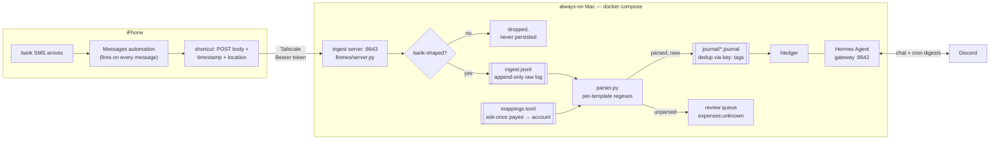

# finmes

Personal finance pipeline: bank SMS on an iPhone become an
[hledger](https://hledger.org) journal on an always-on Mac, with
[Hermes Agent](https://github.com/NousResearch/hermes-agent) as the
conversational layer on top — ask "what did I spend on groceries in June?"
from Discord and it runs the hledger queries.

Design principle throughout: **deterministic writes, agentic reads**. SMS →
journal is pure regex + mapping tables (replayable, testable, no LLM in the
money path). The agent only reads the journal and orchestrates; it never
writes an entry.

## How it works



Key properties:

- **Raw log first.** Every bank-shaped message is appended to `ingest.jsonl`
  *before* any journal write. The journal is derived state — delete the year
  files and replay raw + corpus to rebuild it exactly.
- **Idempotent everywhere.** Dedup keys (`<upi-ref|hash>.<masked-acct>.<direction>`)
  live in the journal itself as `key:` tags. Replays, double-POSTs, and the
  Messages-DB catch-up sweep are all free.
- **The parser is the filter.** The phone forwards *everything*; the server
  decides. A broad financial-looking gate controls only what gets *logged* —
  personal messages return 200 and are never written to disk.
- **Ask-once mappings.** `mappings.toml` maps masked account ids, sender
  prefixes, raw-text markers, and exact payee strings to hledger accounts.
  Unknown payees land in `expenses:unknown` until mapped; use the review and
  recategorize commands to update history.

## The iOS side

Two pieces in the Shortcuts app, deliberately dumb — every attempt at a
smart client failed (see gotchas):

1. **A Messages automation** — trigger "When I get a message", content filter
   effectively always-true, Run Immediately. No sender filtering, no keyword
   filtering: all intelligence is server-side.
2. **A shortcut** the automation runs — takes the message as input and POSTs
   JSON to the Mac's Tailscale Serve HTTPS URL ending in `/ingest`, with the
   bearer token. Start Serve with `tailscale serve 8643`:

   ```json
   {
     "text": "<message body>",
     "sender": "ios",
     "received_at": "2026-07-22T14:03:21+05:30",
     "location": {"lat": "28.65…", "lon": "77.44…"}
   }
   ```

   The response `summary` ("₹165.00 debit, ZEPTOMARKETPLAC") is shown as a
   notification, so every spend gets a glanceable confirmation.

| status | meaning | persisted? |
|---|---|---|
| `parsed` | matched a template, in the journal (`duplicate: true` if already there) | raw log + journal |
| `skipped` | bank noise — OTPs, declines, pre-debit notices | raw log |
| `unparsed` | bank-shaped but no template matched — review queue | raw log |
| `ignored` | not a bank SMS | nothing |

Hard-won gotchas baked into this design:

- **iOS gives shortcuts no access to the SMS sender.** Every property tried
  (Name, `detect.text`, Get Details of Messages) returns the message *body*
  or doesn't exist. Hence `sender: "ios"` hardcoded, and account resolution
  from message content (`[accounts]` masked ids, `[markers]` raw-text
  fallback in `mappings.toml`).
- **`lat`/`lon` arrive as strings**, not numbers. Location is review-time
  context only (map link), never used for merchant resolution.
- **The phone reaches the Mac over Tailscale Serve** in the local deployment.
  The HTTPS URL is private to your tailnet, so keep Tailscale connected on
  the iPhone when the automation sends a message.
- **macOS firewall silently drops inbound** for CLI python — the interpreter
  binary needs its own allowlist entry, separate from Python.app.
- Debugging shortcuts blind is miserable; iCloud syncs them to
  `~/Library/Shortcuts/Shortcuts.sqlite` on the Mac — the `ZSHORTCUTACTIONS.ZDATA`
  blob → `plutil` → JSON gives a full action-level audit of what a shortcut
  actually does.

If the Mac was offline, wait for Messages in iCloud to sync the missed SMS,
then run the recap command on the Mac (outside Docker):

```sh
python3 -m finmes.cli recap 2026-10-10 2026-10-12
```

The dates are inclusive **Messages receipt dates** in the Mac's local time
zone. Recap reads `~/Library/Messages/chat.db` without changing it and adds
newly parsed transactions to `data/journal/`. Existing transaction keys are
skipped; the command reports added, duplicate, and unparsed counts. Give the
terminal running it Full Disk Access in macOS Settings. Wait until the missed
messages are visible in the Mac's Messages app before recapping. SMS recovered
this way have no iPhone Shortcut location tags. Recap writes to the journal,
not to the raw `ingest.jsonl` log.

After moving to a VPS, run recap on the Mac with the remote URL instead:

```sh
python3 -m finmes.cli recap 2026-10-13 2026-10-18 --url https://finmes.unnat.xyz/ingest
```

This reads the synced Messages database on the Mac and sends recovered
messages to the VPS for logging, parsing, categorization, and deduplication.
It leaves the Mac's journal unchanged and uses `FINMES_INGEST_TOKEN` from
the environment or the current directory's `.env`. Dates are inclusive;
rerunning an overlapping range is safe. If interrupted, rerun the same range.
Normal ingestion comes directly from the iPhone Shortcut and needs no Mac.

## Categorizing unknown payees

Discord supports a Mappls + OpenAI Decisions review flow. Add a direct
`OPENAI_API_KEY` to `.env` alongside the existing Mappls and Discord keys.
The Discord frontend sends normal questions to Hermes and handles `/review`
and category confirmation buttons itself; Hermes's journal mount stays read-only.

- Use `/review` to see one unknown payee at a time, newest first. Optionally
  supply an exact payee name to reopen a dismissed review.
- GPS-tagged examples get nearby Mappls candidates (cached for 24 hours).
  Without GPS, the suggestion uses the payee and transaction context.
- Decisions selects from a fixed set of category accounts or says unknown.
  It receives payee, dates, amounts, directions, and nearby place descriptions;
  raw SMS bodies, bank account IDs, UPI references, and exact GPS are omitted.
- **Confirm category** is the only action that saves a mapping. Changing a
  category or requesting a new suggestion does not save it. Authorized Discord
  users can confirm, choose another account, or dismiss the card.
- Confirmation backs up the mapping and journal, updates matching unknown
  history, and preserves historical entries absent from the raw log. Existing
  explicit mappings are never overwritten by a stale card.
- Pending reviews survive bot restarts. Startup seeds the historical backlog
  quietly; new unknown transactions trigger one card per payee in the configured
  home channel (or a DM when no home channel is configured), at most one per poll.
- API failures and uncertain answers leave manual category selection available.
  They never block SMS ingestion or auto-save a category.

Review state is private runtime data at `data/review-state.sqlite3`; keep it out
of Git and include it in secure VPS backups.

The CLI batch review remains available:

Export the unknown payees, ordered by total INR debit amount:

```sh
python3 -m finmes.cli review
```

Open `data/payee-review.tsv`. The `suggestion` column is a hint for a few
obvious merchant names and is never applied automatically. Fill only the
`category` column for payees you recognize (for example,
`expenses:groceries` or `assets:transfers`). Leave uncertain rows empty.
Then apply your choices to future and existing entries:

```sh
python3 -m finmes.cli apply-review
```

For an unknown INR debit **under ₹100**, the receipt time categorizes it as
`expenses:transport:commuting` during 09:00–11:59 or 15:00–19:59, on any day.
An explicit payee mapping always wins. New phone and recap entries store a
`time:` tag. To update older entries, preview then apply recovered times
from the raw ingest log and, if Terminal has Full Disk Access, Mac Messages:

```sh
python3 -m finmes.cli recategorize --db ~/Library/Messages/chat.db
docker compose stop ingest
python3 -m finmes.cli recategorize --db ~/Library/Messages/chat.db --apply
docker compose start ingest
```

Historical entries whose receipt time is unavailable remain uncategorized
unless you map their payee. Historical rewrites save the previous journal
files under `data/backups/`.

## Running it

```sh
cp .env.example .env   # fill in: OpenRouter key, ingest token, API key, (Discord)
git clone git@github.com:unnxt30/finmes-data.git data
docker compose up -d --build
```

For a public HTTPS VPS deployment, see [VPS.md](VPS.md). The local setup builds the
hermes+hledger image, generates `.hermes/.env` from the root `.env`, and
starts the gateway (8642, loopback), ingest server (8643), and Discord frontend. Details, health
checks, Discord linking, and day-2 ops: [instructions.md](instructions.md).

## Layout

```
docker-compose.yml   the whole stack; .env is the single secrets file
finmes/parser.py     SMS → structured Txn (regex per bank template)
finmes/journal.py    Txn → hledger entry (mapping, dedup, rendering)
finmes/server.py     POST /ingest — logging gate, raw log, journal append
finmes/cli.py        `finmes recap` from Mac Messages, `backfill`/`replay`
data/                private finmes-data clone: journal/, mappings.toml, ingest.jsonl
.hermes/             agent state; only config.yaml + the finmes skill tracked
scripts/             corpus extraction from the Mac Messages DB, tooling
tests/               pytest — parser, journal, server (real SMS fixtures)
```

## The agent

Hermes Agent runs in the same container as hledger with a
[skill file](.hermes/skills/finmes-hledger/SKILL.md) distilled from the
hledger manual: question→command recipes, query syntax, and guardrails
(journal is read-only to the agent; never fabricate numbers). Model:
`openai/gpt-6-luna` via OpenRouter, with reasoning effort `none` so Hermes's
Chat Completions tool calls remain available. Every trajectory is persisted
in `.hermes/state.db` (`auto_prune: false`) as a future fine-tuning corpus —
hledger gives verifiable ground truth for filtering traces.

Entries ingested from the phone carry `lat:`/`lon:` tags; the `nearby` tool
in the agent container resolves them to surrounding POIs during payee review.

Roadmap: cron digests (weekly + month-end), payee review loop (batch-ask
unknowns, write mappings), threshold alerts, subscription/autopay audit,
budget reports, and deterministic `finmes reconcile` against monthly bank
statements (backfills missed SMS, catches non-SMS items like interest and
charges, asserts balances).
