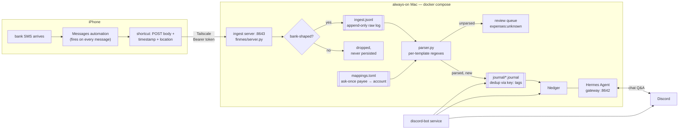

# finmes

Personal finance pipeline: bank SMS on an iPhone become an
[hledger](https://hledger.org) journal on an always-on Mac, with
[Hermes Agent](https://github.com/NousResearch/hermes-agent) as the
conversational layer on top — ask "what did I spend on groceries in June?"
from Discord and it runs the hledger queries.

Design principle throughout: **deterministic writes, agentic reads**. SMS →
journal is pure regex + mapping tables (replayable, testable, no LLM in the
money path). The agent only reads the journal and orchestrates; it never
writes an entry.

## How it works



Key properties:

- **Raw log first.** Every bank-shaped message is appended to `ingest.jsonl`
  *before* any journal write. The journal is derived state — delete the year
  files and replay raw + corpus to rebuild it exactly.
- **Idempotent everywhere.** Dedup keys (`<upi-ref|hash>.<masked-acct>.<direction>`)
  live in the journal itself as `key:` tags. Replays, double-POSTs, and the
  Messages-DB catch-up sweep are all free.
- **The parser is the filter.** The phone forwards *everything*; the server
  decides. A broad financial-looking gate controls only what gets *logged* —
  personal messages return 200 and are never written to disk.
- **Ask-once mappings.** `mappings.toml` maps masked account ids, sender
  prefixes, raw-text markers, and exact payee strings to hledger accounts.
  Unknown payees land in `expenses:unknown` until mapped; remap and replay
  to rewrite history correctly.

## The iOS side

Two pieces in the Shortcuts app, deliberately dumb — every attempt at a
smart client failed (see gotchas):

1. **A Messages automation** — trigger "When I get a message", content filter
   effectively always-true, Run Immediately. No sender filtering, no keyword
   filtering: all intelligence is server-side.
2. **A shortcut** the automation runs — takes the message as input and POSTs
   JSON to `http://<tailnet-ip>:8643/ingest` with the bearer token:

   ```json
   {
     "text": "<message body>",
     "sender": "ios",
     "received_at": "2026-07-22T14:03:21+05:30",
     "location": {"lat": "28.65…", "lon": "77.44…"}
   }
   ```

   The response `summary` ("₹165.00 debit, ZEPTOMARKETPLAC") is shown as a
   notification, so every spend gets a glanceable confirmation.

| status | meaning | persisted? |
|---|---|---|
| `parsed` | matched a template, in the journal (`duplicate: true` if already there) | raw log + journal |
| `skipped` | bank noise — OTPs, declines, pre-debit notices | raw log |
| `unparsed` | bank-shaped but no template matched — review queue | raw log |
| `ignored` | not a bank SMS | nothing |

Hard-won gotchas baked into this design:

- **iOS gives shortcuts no access to the SMS sender.** Every property tried
  (Name, `detect.text`, Get Details of Messages) returns the message *body*
  or doesn't exist. Hence `sender: "ios"` hardcoded, and account resolution
  from message content (`[accounts]` masked ids, `[markers]` raw-text
  fallback in `mappings.toml`).
- **`lat`/`lon` arrive as strings**, not numbers. Location is review-time
  context only (map link), never used for merchant resolution.
- **The phone reaches the Mac over Tailscale** — no public endpoint. The
  tailnet IP changes if you re-login to a different tailscale account.
- **macOS firewall silently drops inbound** for CLI python — the interpreter
  binary needs its own allowlist entry, separate from Python.app.
- Debugging shortcuts blind is miserable; iCloud syncs them to
  `~/Library/Shortcuts/Shortcuts.sqlite` on the Mac — the `ZSHORTCUTACTIONS.ZDATA`
  blob → `plutil` → JSON gives a full action-level audit of what a shortcut
  actually does.

Missed POSTs (phone offline, Mac asleep) are covered by a fallback sweep:
Text Message Forwarding lands the same SMS in the Mac's Messages database,
`scripts/extract_bank_sms.py` extracts them with *real* sender ids, and
idempotent ingest makes re-feeding them free.

## Running it

```sh
cp .env.example .env   # fill in: OpenRouter key, ingest token, API key, (Discord)
git clone <your-private-finmes-data-repo> data
docker compose up -d --build
```

That's the whole setup on a fresh machine — compose builds the
hermes+hledger image, generates `.hermes/.env` from the root `.env`, and
starts the gateway (8642, loopback) and ingest server (8643). Details, health
checks, Discord linking, and day-2 ops: [instructions.md](instructions.md).

## Layout

```
docker-compose.yml   the whole stack; .env is the single secrets file
finmes/parser.py     SMS → structured Txn (regex per bank template)
finmes/journal.py    Txn → hledger entry (mapping, dedup, rendering)
finmes/server.py     POST /ingest — logging gate, raw log, journal append
finmes/discord_bot.py  Discord service — slash commands, digests, payee review
finmes/cli.py        `finmes backfill` — replay an SMS corpus, idempotent
data/                private finmes-data clone: journal/, mappings.toml, ingest.jsonl
.hermes/             agent state; only config.yaml + the finmes skill tracked
scripts/             corpus extraction from the Mac Messages DB, tooling
tests/               pytest — parser, journal, server (real SMS fixtures)
```

## The agent

Hermes Agent runs in the same container as hledger with a
[skill file](.hermes/skills/finmes-hledger/SKILL.md) distilled from the
hledger manual: question→command recipes, query syntax, and guardrails
(journal is read-only to the agent; never fabricate numbers). Model:
`z-ai/glm-5.3-flash` via OpenRouter. Every trajectory is persisted
in `.hermes/state.db` (`auto_prune: false`) as a future fine-tuning corpus —
hledger gives verifiable ground truth for filtering traces.

Entries ingested from the phone carry `lat:`/`lon:` tags; the `nearby` tool
in the agent container resolves them to surrounding POIs during payee review.

The `discord-bot` compose service posts weekly and month-end spending digests
to a home channel, exposes `/spend`, `/recent`, `/search`, `/digest`, and
`/review` slash commands, and routes natural-language questions to Hermes.
See [instructions.md](instructions.md) for setup.

Roadmap: threshold alerts, subscription/autopay audit, budget reports, and
deterministic `finmes reconcile` against monthly bank statements (backfills
missed SMS, catches non-SMS items like interest and charges, asserts balances).
