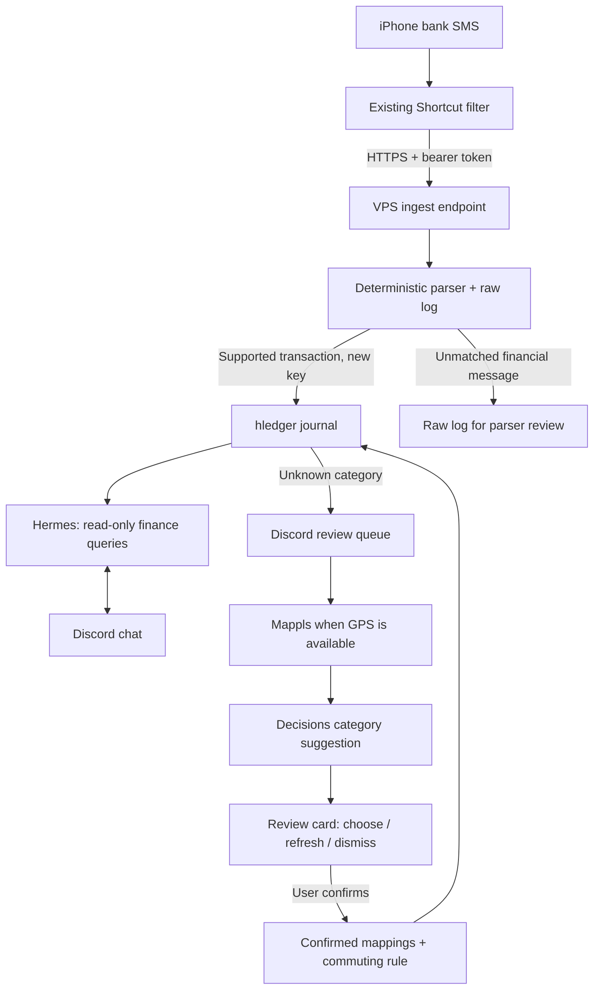

# finmes

Personal finance pipeline: bank SMS received on an iPhone become an
[hledger](https://hledger.org) journal on a VPS. Ask questions in Discord through
[Hermes Agent](https://github.com/NousResearch/hermes-agent), and review unknown
payees using Mappls context and OpenAI Decisions suggestions.

**Current deployment:** GCP VPS, Docker Compose, HTTPS ingestion at
`https://finmes.unnat.xyz/ingest`. The iPhone retains its existing bank/keyword
filter. The Mac is needed only for catching up from synced Messages, not for
normal ingestion. Tailscale is not required for the VPS deployment.

Amounts and transaction details come from deterministic parsing. Hermes reads
the journal; category suggestions only become mappings after you confirm them.

## Features

| Feature | What it does |
| --- | --- |
| iPhone SMS ingestion | Accepts authenticated JSON over HTTPS, with receipt time and optional location. |
| Deterministic transaction parsing | Extracts supported bank SMS templates for UPI, cards, NEFT, IMPS, autopay and other transfers. Unknown formats are retained for inspection, not guessed. |
| Double-entry journal | Stores hledger postings, masked source accounts, payees, references and optional receipt-time/GPS tags. |
| Safe retries | Transaction keys prevent duplicate journal entries when a message is resent, replayed or recapped. Raw log records may still repeat. |
| Account and payee mappings | Resolves source accounts from masked IDs/sender prefixes/content markers and categories from exact payee mappings. |
| Commuting rule | Categorizes otherwise unmapped INR debits under ₹100 in the configured commute windows. |
| Discord finance questions | Sends authorized users' questions to Hermes, which queries hledger over a read-only journal mount. |
| Category reviews | `/review` presents an unknown payee, examples and an optional AI suggestion; explicit confirmation saves it. |
| Mappls context | Uses recorded payment-location tags to fetch nearby places, cached for 24 hours. Nearby places are unverified possibilities. |
| OpenAI Decisions | Suggests a category from fixed choices, or returns unknown. It complements Hermes through a separate direct OpenAI key. |
| Historical updates | Confirmed mappings update matching unknown journal history and apply to future transactions; backups are made before rewriting. |
| Offline catch-up | Recovers an inclusive date range from the Mac's synced Messages database and sends it to the VPS. |
| CLI maintenance | Supports corpus backfill, raw-log replay, TSV category review and preview/apply recategorization. |
| Persistent state | Finance files, pending reviews and Hermes history survive container restarts through mounted storage. |

## How it works



- Financial-looking messages are logged before journal writes. Non-financial
  messages return `ignored` without being persisted.
- `unparsed` messages have no journal transaction; they need a parser/template
  fix. `/review` handles **parsed transactions with unknown payee categories**.
- The raw log, source corpus and confirmed mappings support replay. Preserve
  the journal too: historical entries may not exist in the current raw log.
- Decisions currently classifies payee categories only. Sending all SMS for
  Decisions-based filtering is an experiment under consideration, **not enabled**.

## The iOS side

Keep the existing Messages automation and the Shortcut's bank/keyword matching
for now. No phone-side change is required to use Discord category reviews.

The Shortcut POSTs the message body, receipt timestamp and optional phone location
to `https://finmes.unnat.xyz/ingest`, using
`Authorization: Bearer <FINMES_INGEST_TOKEN>` and JSON content type:

   ```json
   {
     "text": "<message body>",
     "sender": "ios",
     "received_at": "2026-07-22T14:03:21+05:30",
     "location": {"lat": "28.65…", "lon": "77.44…"}
   }
   ```

   The response `summary` ("₹165.00 debit, ZEPTOMARKETPLAC") is shown as a
   notification, so every spend gets a glanceable confirmation.

| status | meaning | persisted? |
|---|---|---|
| `parsed` | matched a template, in the journal (`duplicate: true` if already there) | raw log + journal |
| `skipped` | bank noise — OTPs, declines, pre-debit notices | raw log |
| `unparsed` | bank-shaped but no template matched — raw log for parser review | raw log |
| `ignored` | not a bank SMS | nothing |

Hard-won gotchas baked into this design:

- **The current Shortcut uses `sender: "ios"`.** Account resolution therefore
  relies on message content: `[accounts]` masked IDs and `[markers]` raw-text
  fallbacks in `mappings.toml`. The Shortcut matching step remains unchanged.
- **`lat`/`lon` arrive as strings**, not numbers. Location provides optional Mappls
  context during category review; it does not establish the merchant identity.
- **The VPS URL works independently of the Mac.** For the optional local
  deployment, Tailscale Serve can expose port 8643 to your tailnet instead.
- **macOS firewall silently drops inbound** for CLI python — the interpreter
  binary needs its own allowlist entry, separate from Python.app.
- Debugging shortcuts blind is miserable; iCloud syncs them to
  `~/Library/Shortcuts/Shortcuts.sqlite` on the Mac — the `ZSHORTCUTACTIONS.ZDATA`
  blob → `plutil` → JSON gives a full action-level audit of what a shortcut
  actually does.

## Catch up missed messages

Wait until the missed SMS are visible in the Mac's Messages app after iCloud
sync. Run this **on the Mac, outside Docker**, from the project folder:

```sh
python3 -m finmes.cli recap 2026-10-13 2026-10-18 --url https://finmes.unnat.xyz/ingest
```

- Dates are inclusive **Messages receipt dates** in the Mac's local timezone.
- Give the terminal Full Disk Access in macOS Settings so it can read
  `~/Library/Messages/chat.db`. The database is read without being modified.
- The command uses `FINMES_INGEST_TOKEN` from the environment or the local `.env`
  and sends messages and receipt timestamps to the VPS for logging and parsing.
- The Mac's journal stays unchanged. Overlapping ranges and retries are safe
  because existing transaction keys are skipped. The result reports added,
  duplicate and unparsed/skipped counts.
- Recovered messages have no original iPhone Shortcut GPS tags.
- For an intentional local deployment only, omit `--url` to write directly to
  the Mac's `data/journal/`; that mode does not append to `ingest.jsonl`.

Normal ingestion comes directly from the iPhone Shortcut and needs no Mac.

## Try Discord and Decisions

1. Open the server containing the **finmes** bot. For finance chat, mention the
   bot, for example `@finmes What is my latest transaction?`. In a direct message,
   ask the question without a mention. Only IDs in `DISCORD_ALLOWED_USERS` work.
2. In a server channel where the bot is installed, type `/review` and select the
   **finmes** command. It walks through currently pending payees one at a time.
   Use `/review count:10` to limit the session to 10 payees (allowed range 1–50).
   The review response is visible only to you; no direct API call is needed.
3. Inspect **Category to confirm**, **AI confidence**, **Nearby possibilities**
   when present, and **Suggestion context**. “Suggested by Decisions” means the
   provider returned a suggestion. An insufficient-evidence result is valid;
   unavailable-provider messages mean manual selection is available instead.
4. For a harmless experiment, inspect the card and leave it open, or select a
   different category without confirming. Neither action saves a mapping.
5. **Confirm category** saves the mapping and updates matching unknown history.
   Use **Other category** for a custom hledger account, **Refresh suggestion** to
   request another suggestion, or **Dismiss** to close without saving. To reopen
   a dismissed unknown payee, use `/review` with its exact `payee` option.

Confirming or dismissing automatically loads the next payee in the same card,
with progress such as “2 of 10.” The session stops at its limit or when its
initial queue is exhausted. You can leave at any point; unreviewed payees remain
pending. Selecting or refreshing a category does not advance the session.
An exact `payee` argument limits the session to that payee.

Custom categories become dropdown presets after confirmation, including on future
reviews and after restarts. If choices fill the dropdown, **More categories** and
**Previous categories** let you browse every preset.

A payee
with no location is still reviewable, but cannot exercise Mappls. Mac recap
messages do not contain the original phone GPS. Existing explicitly mapped
payees and entries already covered by the commuting rule are not in this queue.

If `/review` is absent, confirm you installed the bot with the `bot` and
`applications.commands` scopes, reopen Discord, and check the service log for
`/review registered`. If normal chat does not work, check the user allowlist and
Message Content intent in the Discord Developer Portal. A normal chat answer
checks Hermes/OpenRouter; a review suggestion checks the separate Decisions path.

On the VPS, inspect the service status and recent review errors:

```sh
docker compose -f docker-compose.yml -f docker-compose.vps.yml --profile vps ps
docker compose logs --tail=50 discord-bot
```

Do not paste `.env`, authorization headers or raw financial logs into public
support channels. A provider error or missing key never blocks ingestion.

## Categorizing unknown payees

Discord supports a Mappls + OpenAI Decisions review flow. Add a direct
`OPENAI_API_KEY` to `.env` alongside the existing Mappls and Discord keys.
The Discord frontend sends normal questions to Hermes and handles `/review`
and category confirmation buttons itself; Hermes's journal mount stays read-only.

- Use `/review` to work through pending unknown payees, newest first, or
  `/review count:10` to review up to 10. Confirming or dismissing advances to the
  next card. Optionally supply an exact payee name to reopen a dismissed review.
- GPS-tagged examples get nearby Mappls candidates (cached for 24 hours).
  Without GPS, the suggestion uses the payee and transaction context.
- Decisions selects from a fixed set of category accounts or says unknown.
  It receives payee, dates, amounts, directions, and nearby place descriptions;
  raw SMS bodies, bank account IDs, UPI references, and exact GPS are omitted.
- **Confirm category** is the only action that saves a mapping. Changing a
  category or requesting a new suggestion does not save it. Authorized Discord
  users can confirm, choose another account, or dismiss the card. Confirmed
  custom category accounts are included in the presets.
- Confirmation backs up the mapping and journal, updates matching unknown
  history, and preserves historical entries absent from the raw log. Existing
  explicit mappings are never overwritten by a stale card.
- Pending reviews survive bot restarts. Startup seeds the historical backlog
  quietly; new unknown transactions trigger one card per payee in the configured
  home channel (or a DM when no home channel is configured), at most one per poll.
- API failures and uncertain answers leave manual category selection available.
  They never block SMS ingestion or auto-save a category.

Review state is private runtime data at `data/review-state.sqlite3`; keep it out
of Git and include it in secure VPS backups.

The CLI batch review remains available. Run it where the authoritative data
lives (the VPS in the current setup), or prefix commands with
`docker compose exec ingest` to use the deployed container:

Export the unknown payees, ordered by total INR debit amount:

```sh
python3 -m finmes.cli review
```

Open `data/payee-review.tsv`. The `suggestion` column is a hint for a few
obvious merchant names and is never applied automatically. Fill only the
`category` column for payees you recognize (for example,
`expenses:groceries` or `assets:transfers`). Leave uncertain rows empty.
Then apply your choices to future and existing entries:

```sh
python3 -m finmes.cli apply-review
```

For an unknown INR debit **under ₹100**, the receipt time categorizes it as
`expenses:transport:commuting` during 09:00–11:59 or 15:00–19:59, on any day.
An explicit payee mapping always wins. New phone and recap entries store a
`time:` tag. To update older entries, preview then apply recovered times
from the raw ingest log and, if Terminal has Full Disk Access, Mac Messages:

```sh
python3 -m finmes.cli recategorize --db ~/Library/Messages/chat.db
docker compose stop ingest
python3 -m finmes.cli recategorize --db ~/Library/Messages/chat.db --apply
docker compose start ingest
```

The `--db` option above is for a Mac with Messages access. On the VPS, omit it
and recover available receipt times from the raw ingest log instead.

Historical entries whose receipt time is unavailable remain uncategorized
unless you map their payee. Historical rewrites save the previous journal
files under `data/backups/`.

## Running it

```sh
cp .env.example .env   # fill the required keys/tokens listed below
git clone git@github.com:unnxt30/finmes-data.git data
docker compose up -d --build
```

For a public HTTPS VPS deployment, see [VPS.md](VPS.md). The local setup builds the
hermes+hledger image, generates `.hermes/.env` from the root `.env`, and
starts the gateway (8642, loopback), ingest server (8643), and Discord frontend. Details, health
checks, Discord linking, and day-2 ops: [instructions.md](instructions.md).

## Configuration

Use `.env.example` as the template. The root `.env` configures Compose and
generates Hermes's own environment; do not edit `.hermes/.env` directly.

| Variable | Purpose |
| --- | --- |
| `FINMES_INGEST_TOKEN` | Shared secret for the phone/remote recap and ingest endpoint. |
| `API_SERVER_KEY` | Internal authenticated access from the Discord frontend to Hermes. |
| `OPENROUTER_API_KEY` | Hermes finance conversation and tool use. |
| `DISCORD_BOT_TOKEN` | Discord bot login. |
| `DISCORD_ALLOWED_USERS` | Comma-separated Discord user IDs allowed to chat and confirm. |
| `DISCORD_HOME_CHANNEL` | Optional channel for new unknown-payee cards; otherwise DM the first allowed user by numeric ID. |
| `OPENAI_API_KEY` | Direct OpenAI key for Decisions category suggestions; independent of OpenRouter. |
| `MAPPLS_API_KEY` | Optional nearby-place lookup for GPS-tagged reviews and the agent's `nearby` helper. |
| `FIRECRAWL_API_KEY` | Optional agent web search/scraping. |

Changing the laptop's `.env` does not update the VPS automatically. Edit the VPS
file and recreate the affected service. For Decisions/Mappls review settings:

```sh
docker compose -f docker-compose.yml -f docker-compose.vps.yml --profile vps up -d --no-build --no-deps discord-bot
```

## Layout

```
docker-compose.yml   Hermes, ingest, Discord frontend, optional Caddy
Caddyfile            VPS HTTPS reverse proxy
finmes/parser.py     supported SMS templates → structured transactions
finmes/journal.py    source/category mappings, deduplication, journal rendering
finmes/server.py     authenticated ingestion, raw logging and status responses
finmes/cli.py        recap, backfill, replay, review, apply-review, recategorize
finmes/categories.py category review exports and backed-up historical rewrites
finmes/enrichment.py Mappls lookup and direct OpenAI Decisions client
finmes/reviews.py    persistent review queue, authorization and confirmation
finmes/discord_bot.py Discord review cards and chat bridge to Hermes
data/                private journal, mappings, raw log and review state
.hermes/             agent configuration, skill and private runtime history
scripts/             Mac Messages corpus extraction and other tooling
tests/               parsing, ingestion, journals, provider contracts and reviews
```

## Replay and backfill

Run these where the authoritative `data/` lives (the VPS for the current setup):

```sh
python3 -m finmes.cli backfill path/to/corpus.tsv
python3 -m finmes.cli replay data/ingest.jsonl
```

Both skip existing transaction keys. Replays do not fix already-written category
postings; use category review/recategorization for those. To run a CLI command
inside the deployed ingest container, prefix it with
`docker compose exec ingest`, for example:

```sh
docker compose exec ingest python -m finmes.cli review
```

## Storage, privacy and backups

- Keep `data/` private: journal, mappings, raw bank-shaped SMS and backups contain
  financial information. The application repository does not contain these files.
- Back up the journal, `mappings.toml`, `ingest.jsonl`, review SQLite database,
  Hermes runtime databases and Caddy certificate storage securely off the VPS.
  SQLite files should be backed up consistently, using SQLite backup facilities
  or while their writers are stopped.
- Review state is runtime data and is excluded from Git. `.env` and Hermes
  runtime databases must also stay out of Git. Git pushes do not back up secrets
  or all runtime state.
- Mappls receives coordinates for nearby-place searches. Decisions receives the
  limited evidence described above; Hermes receives your questions and tool
  results through OpenRouter. The financial-looking logging gate can retain OTPs
  or other bank notices even though they do not become journal transactions.
- An unavailable VPS does not provide a durable queue for failed Shortcut calls.
  Use Mac Messages recap after synchronization to recover supported messages.

## The agent

Hermes runs alongside hledger with a
[finance skill](.hermes/skills/finmes-hledger/SKILL.md) containing query recipes
and instructions to ground answers in journal results. Its journal mount is
read-only. It uses `openai/gpt-6-luna` through OpenRouter, with reasoning effort
`none` in the current configuration. Chat sessions are scoped per Discord
channel and user. Agent history is retained in `.hermes/state.db` with automatic
pruning disabled.

The Discord frontend handles review commands and confirmation callbacks, and
forwards ordinary questions to Hermes. Decisions is a separate category
classifier; it does not replace the conversational agent or parse transaction
amounts. The agent's `nearby` helper can also look up recorded location tags.

## Development

Python 3.11+ is required. Run the test suite with pytest and the project dependency:

```sh
uv run --no-project --with pytest --with 'discord.py>=2.5,<3' python -m pytest -q
```

## Planned, not enabled

Decisions-based SMS filtering, scheduled weekly/month-end digests, threshold
alerts, subscription/autopay audits, budget reports and bank-statement
reconciliation remain future work. The current Shortcut filter stays in place.
