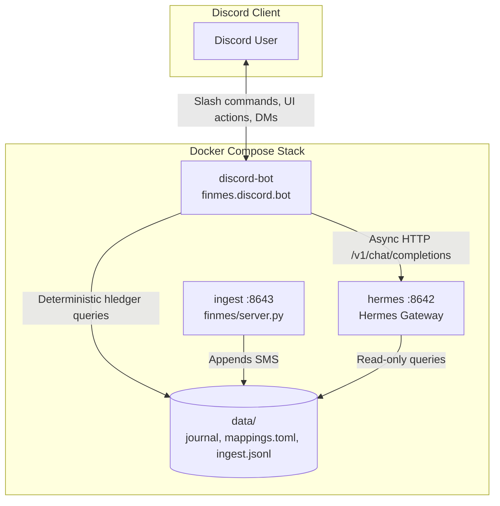

# Discord Frontend Integration Design

## 1. Overview

This document specifies the design for the `finmes` Discord frontend. The Discord bot provides an interactive interface to query transactions, view spending breakdowns, receive digests, and map unknown payees.

The architecture follows the design principle: **deterministic writes, agentic reads**.
- Deterministic operations (slash commands, payee mapping updates, journal rebuilds) execute locally without language model latency.
- Natural language questions route asynchronously to the existing Hermes Agent gateway service.

## 2. Architecture and Service Boundary

The Discord bot runs as a dedicated Python service (`discord-bot`) inside Docker Compose.



### Components

1. **`finmes.discord.bot`**: The bot application based on `discord.py`.
2. **Deterministic Query Engine**: Subprocess wrapper for `hledger` commands. Runs queries directly against `data/journal/main.journal`.
3. **Hermes Gateway Client**: Asynchronous HTTP client that calls `http://hermes:8642/v1/chat/completions` with `API_SERVER_KEY`.
4. **Payee Mapping Handler**: Updates `data/mappings.toml` and triggers an idempotent replay of `data/ingest.jsonl`.

## 3. Interaction Specifications

### Slash Commands

The bot registers the following application commands:

| Command | Arguments | Description |
|---|---|---|
| `/spend` | `period` (optional, default `thismonth`), `category` (optional) | Displays a category spending breakdown and total spend. |
| `/recent` | `limit` (optional, default 10, max 25) | Displays recent journal transactions with dates, payees, and amounts. |
| `/search` | `query` (required) | Searches transactions matching a payee name or description string. |
| `/review` | None | Lists pending `expenses:unknown` transactions with interactive mapping controls. |
| `/digest` | `period` (optional, default `thisweek`) | Generates on-demand spending comparison and budget reports. |

### Interactive Payee Review Workflow

When `/review` runs, the bot creates an embed for an unmapped payee:

1. **Transaction Card**:
   - Date and time
   - Transaction amount in INR
   - Raw payee string from SMS
   - UPI reference if available
   - Location tags (`lat:`, `lon:`) if available

2. **Action Components**:
   - **Common Category Select Menu**: Select from top expense categories (`expenses:food:groceries`, `expenses:food:chai`, `expenses:transport:metro`, `expenses:shopping`).
   - **Nearby POI Button**: Active when location tags exist. Calls Mappls nearby search and shows merchant candidate buttons.
   - **Custom Mapping Button**: Opens a Discord modal dialog with inputs for:
     - Account name (for example, `expenses:health:pharmacy`)
     - Match pattern (defaults to exact payee string)
     - Marker type (`payee` or `raw_text`)

3. **Execution**:
   - Appends the rule to `data/mappings.toml` under the selected table.
   - Rebuilds the derived year journal files from `data/ingest.jsonl`.
   - Updates the Discord message with a confirmation badge and disables mapped action buttons.

The workflow does not map `unparsed` messages. Those messages lack a parsed payee, amount, or transaction date. A parser-template review workflow is outside this design.

### Conversational Natural Language Q&A

1. **Trigger**: Direct messages to the bot or mentions (`@finmes <question>`) in allowed channels.
2. **Execution**:
   - Bot displays a typing status.
   - Sends the message to `http://hermes:8642/v1/chat/completions`.
   - Hermes processes the query with the `finmes-hledger` skill and returns the answer.
   - Bot formats markdown tables and splits messages exceeding 2000 characters into sequential embeds.

### Scheduled Digests

An asynchronous background loop runs in the bot service:
- **Weekly Digest**: Runs every Monday at 08:00 IST. Summarizes previous week spending by category and compares against prior week.
- **Month-End Digest**: Runs on the first day of each month at 08:00 IST. Summarizes total monthly expense, top 5 payees, and unmapped transactions count.
- Posts output directly to `DISCORD_HOME_CHANNEL`.

## 4. Data Flow and Concurrency

### Mapping Updates and Replay

To prevent race conditions during concurrent user actions:
- File write operations on `data/mappings.toml` use an asynchronous lock (`asyncio.Lock`).
- The bot runs a new `finmes.journal.rebuild_journal()` function in a thread executor. The function recreates the derived year journal files from the raw ingest log and replaces them only after a successful rebuild.
- A regular `finmes replay` does not rewrite existing entries because its deduplication prevents duplicate journal keys. It cannot apply a changed mapping to historical entries.

### Error Handling

1. **Hermes Timeout**: If Hermes takes longer than 45 seconds to answer, the bot notifies the user and cancels the request task cleanly.
2. **hledger Query Failure**: Invalid command parameters return a sanitized error message to the user without process termination.
3. **Unauthorized Access**: If an unauthorized user sends a command or message, the bot ignores the message.

## 5. Configuration and Environment

The bot uses the existing `.env` configuration keys:

```env
DISCORD_BOT_TOKEN=        # Bot token from discord.com/developers
DISCORD_ALLOWED_USERS=    # Comma-separated Discord user IDs
DISCORD_HOME_CHANNEL=     # Channel ID for scheduled digests
API_SERVER_KEY=           # Auth token for Hermes Gateway API
LEDGER_FILE=              # Path to main.journal (/opt/journal/main.journal in container)
```

## 6. Testing Strategy

1. **Unit Tests (`tests/test_discord_commands.py`)**:
   - Test command parsing for `/spend`, `/recent`, `/search`, and `/review`.
   - Test formatting utilities for Discord embeds and table truncation.
2. **Integration Tests (`tests/test_discord_mappings.py`)**:
   - Test `mappings.toml` write operations and subsequent journal rebuild calls.
3. **Mock Tests (`tests/test_discord_hermes.py`)**:
   - Mock Hermes `/v1/chat/completions` HTTP responses, timeouts, and error states.
